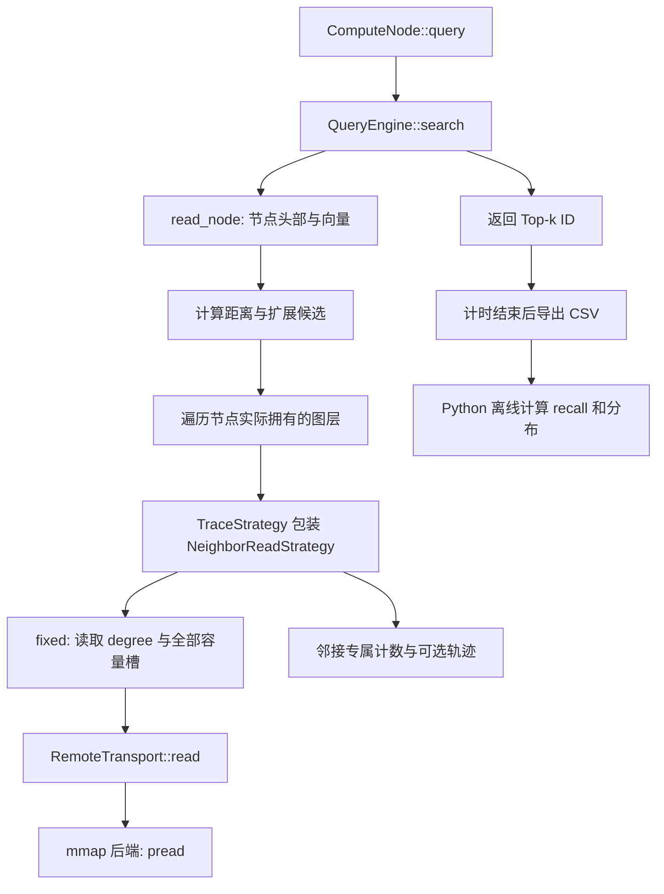

# 一次查询的读取路径

底座文件来自教师提交 `1fc068b8442b24592de635099ffb45dc7bcd42ef`，阅读入口依次是 `graph_store.h`、`query_engine.cc`、`read_strategy.cc`、`mmap_transport.cc` 和 `compute_node.cc`。

当前 x86_64 布局中 `IndexHeader` 为 64 字节，`NodeDiskHeader` 为 24 字节。offset 表按节点 ID 存放各记录的文件起点。节点记录先存节点头部，再存 dim 个 float，随后为每层的 4 字节 degree 和预留邻居槽。

M＝16 时，底层容量 2M＝32，上层容量 M＝16。因此 fixed 的一次底层邻接请求是 `4 + 32*4 = 132` 字节；真实 degree＝10 时仅 44 字节有用，88 字节浪费。向量及节点头部的请求另为 `24 + dim*4` 字节；dim＝128 时是 536 字节。邻接策略比较必须把两类流量分开。

`node_layer_offset()` 从节点 offset 加上节点头部和向量长度，再跳过前面各层的完整预留容量。文件为每个节点预留到全局 max_level 的所有层，但查询只遍历到该节点实际 level；全图分布也排除了未激活的预留层。

QueryEngine 的教学搜索会在每个扩展节点上遍历它拥有的多层邻居，并读取候选节点向量。它保留了一个累计 visited_nodes/read metrics；实验程序用查询前后的差分统计单次查询。该实现的性能结果需要按教学底座解释，不能直接当作成熟分布式 HNSW 系统的结果。

`QueryEngine::run()` 的 elapsed_ms 会包含暴力真值计算；实验入口改用 `query()`，离线核验独立执行。

本地 `ComputeNode::update()` 成功后会自动 reload，重建 QueryEngine。为了拆开耗时，预算试测用 StorageEngine::apply 后显式调用 node.reload。后续缓存策略必须把状态保存在 QueryEngine 外，并在 reload 后重新注入；否则动态试验会意外变成每次更新后的冷缓存试验。
